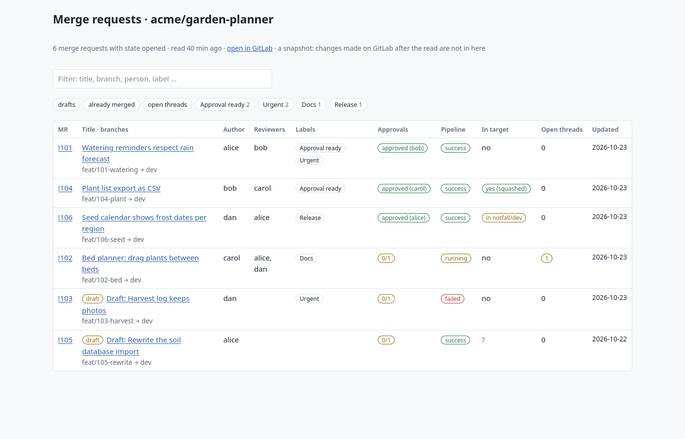
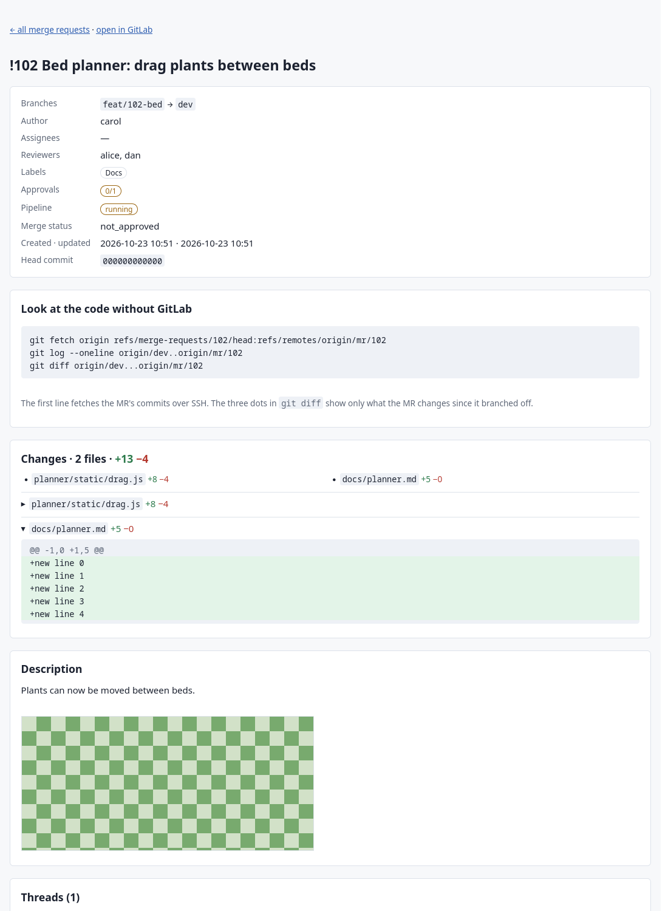

# mr-export — GitLab merge requests as a local, offline overview

Keep a local copy of every open merge request — description, labels, reviewers,
approvals, pipeline, comment threads, images, the diff, and whether its change is
already in the target branch — refreshed on a timer, and readable in a browser
when GitLab is down.



## The problem

Your team works with merge requests on a self-hosted GitLab. When that server is
down, Git over SSH may still work, but everything that lives only in GitLab's
database is gone for the duration: what each MR is about, who reviews it, which
threads are still open, what the screenshots showed. People start merging locally,
and labels like "already deployed" stand in for facts nobody can check.

## The idea

- **A standing copy.** A systemd user timer runs `mr-export fetch` while you are
  logged in. Each run writes a new snapshot folder; `latest/` always points at the
  newest finished one; the newest 15 complete snapshots are kept.
- **Read only, checked.** Every GitLab request is a GET through `glab api`; one
  place builds those calls and refuses any option that could write.
- **Git, not labels.** Over SSH the tool fetches the target branches and every
  MR's commits into its own ref namespace (`refs/mr-export/…` — your branches and
  `origin/*` stay as they are) and records per MR whether its change is already in
  the target branch — also when it was squashed or cherry-picked — and its diff.
- **Offline pages.** `index.html` and one page per MR, no CDN, no web fonts; images
  and diffs come from the snapshot.
- **Explain-then-run.** Before the first request a header says what is read from
  where and where it goes; then it asks. Every external command is printed with a
  one-line explanation. `--quiet` (for the timer) prints only problems.

## Requirements

- Python 3.12 (standard library only), Git ≥ 2.38 (`git merge-tree --write-tree`)
- [`glab`](https://gitlab.com/gitlab-org/cli), logged in to your GitLab host
  (`glab auth status`). `mr-export` uses glab's login; it never sees a token.
- For the timer: systemd (user instance). For screenshots of the demo: Firefox.

## Setup

```bash
ln -s "$PWD/dev/mr-export/mr-export" ~/.local/bin/mr-export   # once
cd ~/code/your-app                                           # a clone whose origin is on GitLab
mr-export fetch                                              # shows what it will do, asks, reads
mr-export open                                               # opens latest/index.html
```

## Keep it current

```bash
mr-export schedule --every 1h     # shows both unit files, asks, then enables the timer
mr-export schedule --status       # next run, last run, the last 20 journal lines
mr-export schedule --off          # stop and remove
```

- The timer runs `mr-export fetch --yes --quiet --repo <clone>` only while you are
  logged in, so glab's keyring and your SSH agent are available. If timer runs
  cannot see the agent, `schedule` says so and names the fix
  (`systemctl --user import-environment SSH_AUTH_SOCK`).
- Two fetches never run at once for the same repository; the second one stops
  with a message.
- When GitLab does not answer, no folder is made and `latest` stays where it was.
  A run that finishes with gaps (say the API answered but SSH did not, or one image
  failed) is marked **partial**: it becomes `latest` when it is the newest run. The
  newest `keep` complete snapshots always stay; partial runs newer than them are kept
  up to the same number, older partial runs are removed once a complete one exists.

Snapshot layout:

```
<out_dir>/<repo>/
  latest -> 2026-01-14_1100/              newest finished snapshot
  2026-01-14_1100/
    meta.json  mrs.ndjson  members.ndjson  git.json  index.html
    mr/<iid>.json  mr/<iid>-discussions.ndjson  mr/<iid>-approvals.json
    mr/<iid>.diff  mr/<iid>.html
    uploads/<secret>/<file>
```

## Open it

`mr-export open` opens `latest/index.html` with your default browser, or open that
file by hand (bookmark it). **Browsers installed as a Flatpak** (Chrome or Chromium
from Flathub, for example) only see the single file they were handed; the overview
shows, but every link from it fails. `open` detects this and prints the one-time
fix, which you run yourself:

```bash
flatpak override --user --filesystem=~/mr-export:ro com.google.Chrome
flatpak override --user --reset com.google.Chrome     # to take it back
```

## What the overview shows

- **Order:** non-drafts before drafts; within each, MRs with a label from
  `top_labels` (default `Approval ready`) first; then the most recently updated.
- **Filters:** a chip per label with its count, plus *drafts*, *already merged* and
  *open threads*; chips combine with each other and with the text box.
- **In target**, read from Git: `yes` (the MR's commits are in the target branch),
  `yes (squashed)` (the target already holds the same changes), `in notfall/dev`
  (not in the target, but in its emergency branch), `no`, `unclear (conflict)`, or
  `?` (not readable). *unclear* means merging the MR into its target would conflict:
  usually it is not merged yet, but a change that was squashed and then edited again
  on the target looks the same.
- **Age:** "read 40 min ago", computed in the browser when you open the page; red
  after `stale_after_hours` — set it to about three times your timer interval. Gaps of a partial run are listed on top.

Each MR page has the description with its images, the threads (with file and
line), the system activity, the `git` commands to look at the code without GitLab,
and the diff — one block per file; long files, very long lines and very large MRs
are cut (the rest of the files stay listed with their counts) next to the full
`git diff` command.



## Config

Optional, TOML, at `~/.config/mr-export/mr-export.conf` — see
[`example.conf`](example.conf). Global keys at the top; a `[repo."<clone folder
name>"]` table overrides them for one repository.

| Key | Default | Meaning |
|---|---|---|
| `out_dir` | `~/mr-export` | where snapshots go |
| `state` | `opened` | which MRs to read (`opened`, `merged`, `closed`, `locked`, `all`) |
| `images` | `true` | download files uploaded to texts |
| `keep` | `15` | complete snapshots kept (and at most as many newer partial ones) |
| `top_labels` | `["Approval ready"]` | labels sorted to the top |
| `emergency_branches` | `{ dev = "notfall/dev", main = "notfall/main" }` | also checked for "in target" |
| `stale_after_hours` | `3` | when the age turns red |

## Commands

```
mr-export fetch [--state …] [--no-images] [--no-render] [--yes] [--quiet] [--repo DIR]
mr-export render [SNAPSHOT_DIR] [--repo DIR]
mr-export open [--repo DIR]
mr-export schedule --every 30min|1h|2h [--yes] [--repo DIR] | --off | --status
```

`fetch` prints the path of `index.html` on stdout; exit code 1 when anything could
not be read. `render` also reads a flat folder made by hand with plain `glab api`
calls (`mrs-list.ndjson`, `mr-<iid>.json`, `mr-<iid>-discussions.ndjson`).

## Limits

- A snapshot, not a mirror: changes on GitLab after the read are not in it.
- Markdown is shown as text with a small subset turned into markup (code blocks,
  inline code, images, links, bold, headings); tables and lists stay plain text.
- Snapshots contain your project's texts and images. Keep `out_dir` outside any
  repository and treat it like the project itself.

## Demo and tests

```bash
python3 dev/mr-export/demo/make_demo.py /tmp/mr-demo                 # invented data, rendered
python3 dev/mr-export/demo/make_demo.py /tmp/mr-demo --screenshots dev/mr-export/docs/img
python3 -m pytest -q dev/mr-export/tests
```

The tests need no network, no `glab` and no `systemctl`: fakes answer those and
record every call. Git state is tested against real throwaway repositories.
